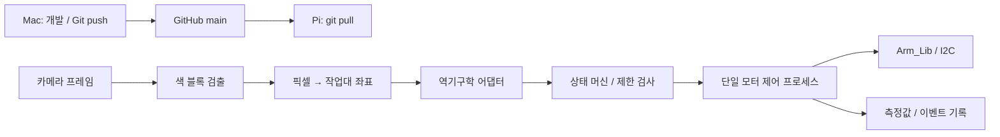

# 카메라 인식 → 집기 개발 설계

상태: 설계안. 아래의 새 모듈과 자동 집기 기능은 아직 구현하지 않았다.

첫 목표는 고정된 작업대에서 일정한 높이의 색 블록 하나를 찾아 집고 지정된 위치에 놓는 것이다. 색·크기·조명·배경을 제한해 카메라 좌표, 로봇 좌표, 실제 집기의 연결부터 검증한다. 여러 물체·일반 객체 탐지·VLA는 이 흐름이 확인된 뒤 확장한다.

## 현재 장비에서 확인한 사실

2026-11-02 SSH 점검. 아래는 점검 당시의 상태이며 전원 재인가 후 다시 확인한다.

| 항목 | 확인 결과 / 확인 방법 |
| --- | --- |
| 보드 | Raspberry Pi 4 Model B Rev 1.5, ARM64 (`/proc/device-tree/model`, `uname`) |
| 환경 | Ubuntu 20.04.3, Python 3.8.10, RAM 약 3.7GiB |
| 라이브러리 | `Arm_Lib` 0.0.5의 설치 egg 소스 확인, OpenCV import 결과 4.8.1, NumPy 패키지 메타데이터 1.17.4 |
| 카메라 | `/dev/video0`, USB 2.0 Camera (`/sys/class/video4linux/video0/name`) |
| 조이스틱 | `/dev/input/js0`, Microntek USB Joystick (`/sys/class/input/js0/device/name`) |
| 모터 통신 | SDK 생성자가 SMBus 1, 주소 `0x15` 사용. 이름에 serial이 있어도 이 설치본은 I2C 통신 |
| 서비스 | `yb-bigProgram`, `yb-rosstart`, `yb-jupyterlab`, `dofbot_oled` 실행 중 |
| 장치 점유 | `fuser -v`에서 제조사 `YahboomArm.pyc`가 video0와 i2c-1, OLED 프로그램이 i2c-1 사용 |
| 연결 / 배포 | Tailscale, SSH, VNC 사용 가능. Git pull 점검 완료. Samba는 기본 서비스만 설치 |

제조사 자료 위치는 `~/Dofbot`, 앱은 `~/Arm`, ROS 작업공간은 `~/catkin_ws`와 `~/dofbot_ws`다. 우리 저장소는 `~/dof-bot`이며 대소문자까지 구별한다. 제조사 코드·모델·개인 설정은 공개 저장소에 복제하지 않는다.

`~/Dofbot/1.telecontrol/4.arm_handle/arm_handle.ipynb`에는 브라우저 `ipywidgets.Controller` 기반 예제가 있다. Pi의 `/dev/input/js0`를 직접 읽는 구현으로 간주하면 안 된다. 예제는 시작 각도를 90도로 가정하므로 우리 수동 제어는 실제 읽은 각도에서 시작하도록 새로 구현한다.

`~/catkin_ws/src/arm_info/src/kinemarics_arm.cpp`는 ROS Noetic의 `get_kinemarics` 서비스를 제공한다. 확인한 소스는 도구 길이 0.12m, 목표 y에 따른 Roll 공식, `tar_z >= 0.20` 분기를 사용한다. FK 주석은 끝점을 5번 모터 회전 중심으로 정의한다. 이를 범용 6D 자세 솔버나 실제 그리퍼 끝점으로 가정하지 않는다. 응답에는 별도의 성공 플래그가 없으므로 어댑터에서 유효성 검사가 필요하다.

이번 점검은 코드·서비스·장치 경로 확인과 `preflight.py` 실행까지다. 카메라 프레임, 서보 각도, 실제 동작, 보정값, 물체 집기 성공은 검증하지 않았다.

## 구성과 책임

첫 버전은 Pi에서 영상 처리와 제어를 수행한다. 먼저 처리 지연과 CPU 사용률을 측정하고, 무거운 탐지 모델이 필요해질 때 인식을 Mac 또는 별도 컴퓨터로 옮긴다. 원격 인식 결과를 도입해도 Pi가 명령의 유효성·시간·허용 범위를 최종 검사한다.

제안 디렉터리이며 아직 존재하지 않는다:

| 경로 | 책임 |
| --- | --- |
| `src/dofbot_app/hardware.py` | SDK 접근, 읽기 재시도·시간 제한, 명령 직렬화 |
| `src/dofbot_app/camera.py` | 단일 캡처 소유자, 프레임 ID와 촬영 시각 |
| `src/dofbot_app/perception.py` | 색 범위·면적·형상 조건으로 후보 검출 |
| `src/dofbot_app/calibration.py` | 카메라/작업대 변환과 보정 파일 검증 |
| `src/dofbot_app/kinematics.py` | 제조사 ROS 솔버 격리, 단위·좌표·관절 오프셋 변환 |
| `src/dofbot_app/controller.py` | 승인된 한 번의 집기 순서, 오류·취소 처리 |
| `src/dofbot_app/cli.py` | 관찰, 계획 미리보기, 명시적 동작 시작 |
| `config/example.yaml` | 비밀값 없는 설정 스키마와 예제. 실제 장비 보정값은 로컬 저장 |
| `tests/` | 장치 없이 경계·실패 동작을 검사하는 가짜 하드웨어 테스트 |

ROS는 우선 기존 역기구학 서비스의 어댑터에만 한정한다. 기존 OS와 SDK를 보존하고 전역 Python 라이브러리 일괄 업그레이드를 피한다. 새 의존성은 Pi에서 재현 가능한 별도 환경에 고정하며, 시스템 제공 SDK·OpenCV·ROS와의 import 호환성을 먼저 확인한다.

## 제어권과 동작 조건

1. 카메라와 모터의 소유자를 하나로 만든다. 우리 모드 진입 시 제조사 앱, 해당 장치를 사용하는 노트북 커널, 다른 제어 프로세스를 확인하고 종료한다. OLED의 I2C 공유도 점검하고 초기 검증 동안 필요하면 정지한다. 점검만으로 서비스를 자동 정지시키지 않는다.
2. 우리 모드로 진입해 제조사 서비스를 정지하기 전에 원래 active 상태를 기록하고, 제조사 모드로 복구할 때 그 상태만 되돌린다. `yb-rosstart`의 기구학 서비스는 장치 점유 여부를 확인한 뒤 필요에 따라 유지한다. 이번 조사에서는 어떤 제조사 서비스도 정지하거나 비활성화하지 않았다.
3. 우리 프로세스끼리는 파일 잠금으로 중복 실행을 거부한다. 이 잠금은 제조사 앱을 막지 못하므로 서비스·장치 점유 확인도 필수다. 자동 모터 서비스는 첫 버전에서 켜지 않는다.
4. 초기 상태는 관찰 전용이다. 필요한 관절 6개를 모두 읽고, 장비별 허용 범위·속도·작업 영역·보정값을 확인해야 동작을 허용한다. SDK 각도 최대치는 기구적 충돌 없는 범위와 같지 않다.
5. SDK의 일부 쓰기 함수는 오류를 출력하고 예외를 삼킨다. 호출이 반환됐다는 사실을 이동 성공으로 취급하지 않는다. 명령 후 읽은 위치, 시간 초과, 사람이 확인한 실제 움직임을 구분해서 기록한다.
6. 소프트웨어 취소는 새 명령과 다음 단계를 차단한다. 이미 보낸 이동을 즉시 멈추는지는 미확인이다. 물리적 전원 차단 수단을 작업자가 사용할 수 있어야 하며, 자동 토크 해제·홈 복귀는 낙하나 충돌 가능성을 검증한 뒤 별도 설계한다.

현재 `arm_smoke.py`는 한 관절이라도 읽히면 읽기 모드가 성공하며, 이동 검증도 방향만 확인한다. 전체 로봇 준비 완료나 집기 성공 판정으로 사용하지 않는다. 먼저 이 판정과 제어권 확인을 보강한다.

## 카메라 좌표와 집기 계획

- 카메라가 고정형인지 팔 부착형인지 먼저 확인한다. 고정형은 장착·해상도·작업면 높이가 바뀌면 다시 보정한다. 팔 부착형은 검증된 관찰 자세에서 촬영하고, 팔이 움직이는 동안 이전 픽셀 변환을 재사용하지 않는다. 이동 중 관찰은 별도의 외부 보정 설계가 필요하다.
- 블록 윗면의 높이를 일정하게 제한하고, 그 높이의 평면에서 픽셀→로봇 기준 좌표 변환을 보정한다. 렌즈 왜곡을 고려하고, 보정에 쓰지 않은 측정점을 이용해 실제 위치 오차를 확인한다. 임의 높이 물체에는 이 평면 변환을 그대로 적용하지 않는다.

평면 변환의 적용 조건은 [OpenCV homography 설명](https://github.com/opencv/opencv/blob/4.x/doc/tutorials/features2d/homography/homography.markdown), 렌즈 보정은 [OpenCV calibration 문서](https://docs.opencv.org/4.5.4/d9/d0c/group__calib3d.html)를 참고한다. 아래 계약과 단계는 이 프로젝트의 설계 선택이며 실물 검증 전이다.

- 관절은 도(degree), 작업대 좌표는 미터(m), 영상 좌표는 픽셀로 계약을 고정한다. 축 방향, 원점, 그리퍼 끝점 오프셋, 5개 팔 관절과 그리퍼의 대응은 실제 장비 확인 후 보정 파일에 기록한다.
- `Observation`에는 프레임 ID, 단조 시각, 카메라 자세/보정 ID, 후보 위치·크기·검출 점수를 넣는다. 색 기반 점수는 확률로 부르지 않는다. 여러 후보·오래된 프레임·작업 영역 밖 후보는 실행하지 않는다.
- 계획은 관찰 → 목표 선택 → 접근 → 하강 → 닫기 → 들어올리기 → 지정 장소 이동 → 놓기 → 확인 순서다. 각 구간의 시작/목표 각도와 보간 중 제한을 검사하고, 측정된 허용 오차 안에 도달했을 때만 다음 단계로 넘어간다. 수치는 실측 후 정하며 기본값만으로 동작시키지 않는다.
- 모터 각도만으로 물체를 잡았다고 판단하지 않는다. 처음에는 작업자가 실제 집기와 놓기를 확인하고 기록한다. 이후 별도 촬영 시점의 영상으로 확인하되 가림·낙하·빈 집기를 구별하지 못하면 결과를 미확인으로 남긴다.
- 실행 승인 직전에 관찰 시각·현재 관절각·보정 ID를 재검사한다. 유효 기간을 넘거나 계획 전제가 바뀌면 재관찰·재계획한다. 오류 시 다음 명령을 차단하고 작업자 개입 상태로 전환한다. 물체를 들고 있을 때의 지지와 복구는 작업자가 판단하며 자동 열기·복귀를 하지 않는다.

## 구현 순서와 통과 조건

| 단계 | 산출물 | 다음 단계로 넘어갈 조건 |
| --- | --- | --- |
| 1. 제어권 확보 | 모드 전환 절차, SDK 어댑터, 강화된 관절 점검 | 경쟁 프로세스 없음, 6개 각도 반복 읽기 성공, 오류·읽기 실패 시 이동 금지 |
| 2. 관찰 | 단일 프레임 캡처와 색 블록 오버레이 | 작업자가 실물과 검출 결과 대조, 빈 화면·복수 후보에서도 이동 없음 |
| 3. 좌표 보정 | 카메라/작업대/그리퍼 보정 파일 | 별도 측정점의 오차가 대상 블록과 그리퍼 여유로 정한 허용치 이내 |
| 4. 계획 미리보기 | IK 어댑터와 상태 머신, 동작 없는 계획 출력 | 도달 불가·범위 초과·오래된 프레임·SDK 오류를 주입하면 차단; 모터 쓰기 0회 |
| 5. 수동 승인 집기 | 구간별 승인 실행과 로그 | 작업자가 저속 접근·들기·놓기를 확인. 빈 집기·낙하를 성공으로 기록하지 않음 |
| 6. 제한된 자동화 | 한 번 실행하는 pick 명령 | 고정 조건에서 반복 실물 확인, 실패 시 중단 및 원인 보존. 기준 충족 후에만 반복 운전 검토 |

기록할 항목은 코드 SHA, 보정 ID, 프레임 ID·시각, 요청/실측 관절각, 단계별 시간, 오류, 작업자 확인 결과다. 실제 동작 검증은 가짜 하드웨어 테스트와 별도 기록한다. 현재는 성공률이나 정밀도를 주장할 근거가 없다.

## 개발·배포·복구

Mac에서 코드와 문서를 수정해 GitHub에 push한다. Pi에서는 동작을 종료하고 변경 없는 작업트리에서 `git pull --ff-only` 후 `python3 preflight.py`를 실행한다. 프로그램을 재시작할 때는 다시 관찰 모드부터 시작한다. 업데이트를 모터 동작 중 자동 실행하지 않는다.

배포마다 `git rev-parse HEAD`로 SHA를 기록한다. 되돌릴 때는 동작을 중지하고 기존 파일·로컬 데이터를 보존한 상태에서 확인된 이전 SHA로 checkout한다. 이후 최신 배포로 복귀할 때는 `git switch main` 후 fast-forward pull한다. `git reset --hard`로 현장 변경을 지우지 않는다.

장치의 Tailscale 주소, 비밀번호, 토큰, 실제 보정값, 영상과 로그는 공개 저장소 밖에 둔다. 코드 관리는 Git, Samba는 별도 데이터 폴더 교환용으로 사용한다. Samba 공유 경로·계정·권한 설정은 아직 미완료다.

## 바로 다음 작업

첫 구현은 **제어권 확인 + 6개 관절 점검 + 카메라 한 장 관찰**이다. 실제 하드웨어를 사용하는 실행 전에 작업자가 카메라 장착 위치, 블록 크기·높이, 작업대 범위, 전원 차단 방법을 확인해야 한다. 자동 집기 코드부터 작성하지 말고, 이 정보를 관찰·보정 단계의 입력으로 확정한다.
